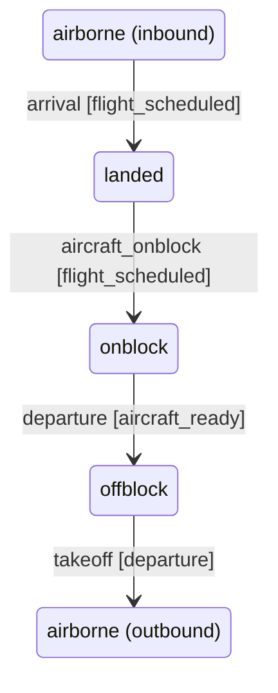
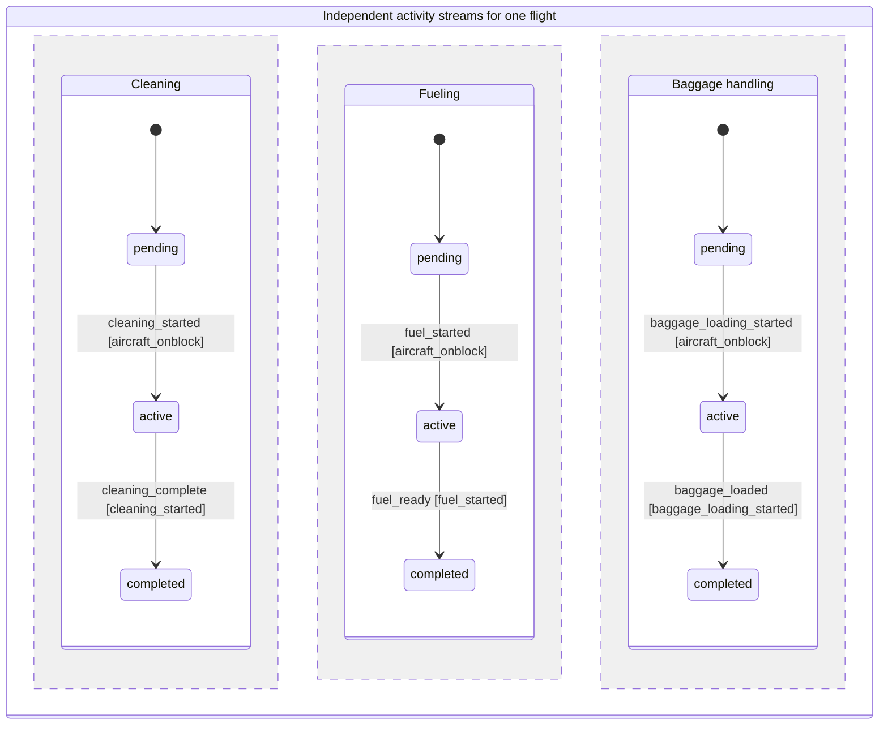
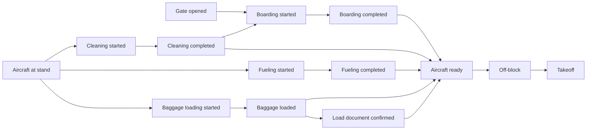

# Atomic operational ledger

## Research and scope

EUROCONTROL's [A-CDM specification](https://www.eurocontrol.int/publication/eurocontrol-specification-airport-collaborative-decision-making-cdm) describes tracking turnaround progress through milestones, with partners supplying information that influences downstream estimates. The [implementation manual](https://www.eurocontrol.int/publication/airport-collaborative-decision-making-cdm-implementation-manual) distinguishes a significant milestone from a general operational event.

[IATA AIDX](https://www.iata.org/en/publications/info-data-exchange/) models flight identification, operational times, resources and disruption information. [Schiphol's public Flight API](https://developer.schiphol.nl/apis/schiphol-public-flight-api-4-public-prd/versions/7e467a47-1065-4998-b293-ef9bb4efbe24/operations/flightByIds) is a concrete example of separate flight IDs, gate resources, scheduled times, estimates and actual off-block/landing times.

These are domain references, not a claim that all airports use one database schema. FlyLeaf's implementation is a local event model inspired by them. It does not implement or certify A-CDM, exchange AIDX messages, issue ATC clearances, or replace an airport's approved operating procedures.

## One event, one operation

[`event_rules.py`](../backend/app/operations/event_rules.py) is the controlled vocabulary. A state-changing event belongs to one activity stream and has allowed prior states, a resulting state, and prerequisite event kinds. Unknown new kinds are rejected. Observations (an unconfirmed staffing situation, a missed deadline) are distinct from physical actions. Control events remain in the run archive.

A flight has independent planning, gate allocation, responsibility, reserve, aircraft, cleaning, fueling, baggage, gate, boarding, load-document and readiness streams. A staff member's attendance is a separate stream. Airport work orders use explicit inspection, lighting, maintenance, shift-handover and SOP-review kinds; there are no newly generated `airport_2_3` actions.

## State machines

The ledger records a **set of cooperating state machines**, rather than one global airport status. Each accepted event changes one subject's state in one activity stream. A flight may have cleaning completed, fueling active and boarding pending at the same time. Boxes below are states; arrow labels are the exact event kinds from the code. Brackets name required earlier events, not actions that run automatically.

### Aircraft movement

The two `airborne` boxes distinguish arrival and departure in the drawing; the stored state value is the same. This is a movement sequence, not an instruction to reuse one flight identity for unrelated flight legs. An outbound-only fixture can start its aircraft stream at `landed` before recording `aircraft_onblock`; it does not need an invented landing event. Reaching `onblock` does not start handling automatically, and becoming ready does not automatically record departure.

### Parallel ground activities

The separated regions can progress independently. The initial markers mean each stream defaults to `pending` before its first event; they do not persist an operation. One stream completing does not complete the others. This diagram describes the implemented concurrency model, not permission to perform every combination of ground activities under a real airport's safety procedures.

### Responsibility, access and departure guards

These related machines supply the conditions for the movement and handling diagrams. `assigned → assigned` still records a meaningful atomic change: the responsible person changes, with the previous assignee retained in the audit.

| Stream / subject | State transitions | Required evidence or guard |
| --- | --- | --- |
| Planning / flight | `unscheduled` → `scheduled` via `flight_scheduled` | Identified flight |
| Gate allocation / flight | `unassigned` → `assigned` via `gate_assigned` | `flight_scheduled` |
| Responsibility / flight | `unassigned` → `assigned` via `staff_assigned`; `assigned` → `assigned` via `staff_substitution` | Initial assignment requires `gate_assigned`; substitution requires `staff_assigned` and the replacement's current attendance |
| Reserve / flight | `unassigned` → `assigned` via `reserve_assigned` | `gate_assigned` |
| Attendance / person | `absent` → `present` via `nfc_check_in`; `present` → `absent` via `nfc_check_out` | Identified person; checked independently of any one flight |
| Gate / flight | `closed` → `open` via `gate_open`; `open` → `closed` via `gate_close` | Opening requires `gate_assigned`; closing requires `gate_open`; both require the operator to be currently checked in |
| Boarding / flight | `pending` → `active` via `boarding_started`; `active` → `completed` via `boarding_completed` | Start requires `gate_open` and `cleaning_complete`; completion requires `boarding_started` |
| Load documents / flight | `pending` → `completed` via `loadsheet_confirmed` | `baggage_loaded` |
| Readiness / flight | `not_ready` → `ready` via `aircraft_ready` | **All five:** `boarding_completed`, `cleaning_complete`, `fuel_ready`, `baggage_loaded`, `loadsheet_confirmed` |
| Alert / flight | `clear` → `raised` via `emergency_declared`; `raised` → `clear` via `emergency_cleared` | Clearing requires `emergency_declared`; alert state is separate from aircraft movement |

The live command service also checks permissions, run revisions, gate availability and replacement assignment. The table describes the transition vocabulary and its explicit guards, not an exhaustive airport clearance checklist. For example, `gate_close` is recorded but is **not currently an explicit prerequisite** of `aircraft_ready` in `RULES`; the diagram must not imply that it is. Work-order streams (inspection, maintenance, handover and SOP review) have their own ordered transitions in the same rule catalog.

`staff_absent`, `gate_waiting` and similar observations record evidence without moving an aircraft or changing a person's attendance state. A red/yellow delay indicator is computed from timing; it is not a new physical state. Invalid new transitions fail before persistence. An accepted live event and its immutable fact projection are written in the same transaction; planned/projected rows do not become completed facts.

## Dependencies between activities

Unlike the state diagrams above, this graph connects **events**. Every incoming edge is required: aircraft readiness is an AND condition, not a choice between completed activities. Dependencies constrain order where needed without forcing all work into a single sequence.

There is no artificial dependency from cleaning completion to fueling start, or from fueling completion to baggage loading. The generated historical turns overlap these streams. The UI exposes their actual intervals under “Activități în paralel”.

Opening a gate with a replacement records responsibility reassignment and gate opening as separate events in the same transaction. Presence is a prerequisite for a person's gate action. Opening/closing the gate still affects the existing boarding-duration calculation. Incoming landing and arrival at the stand are separate events.

## Identity and audit

- `operation_entities`: independent airport-scoped records for flight legs, gates, operational people, teams/sources and airport work orders. A flight occurrence has its own identity; a callsign alone is not a flight key. Gate/person identities persist across flight occurrences. Operational staff and authenticated FlyLeaf accounts occupy different identity namespaces.
- `operation_events`: existing append-only source stream for current/run actions, including authenticated recorder, participant, run ID, ingestion sequence, operational elapsed time, UTC receipt time and payload. Current writes still use simulation revision checks and transaction retries.
- `operation_facts`: immutable audit projection of actual ledger entries, including typed transition, dependency event IDs, original source, participant/recorder references, operational time and original recording time where available. Live facts are indexed in the source transaction, without requiring someone to open the ledger.
- `operation_fact_entities`: foreign-key links between facts and entities, with explicit roles. Entity history is paginated, deduplicated by fact ID and tenant scoped.

Database triggers prevent UPDATE/DELETE on facts and their entity links in SQLite and PostgreSQL. ORM hooks also reject updates/deletes. A stored SHA-256 digest permits verification of the stored snapshot. This is not an external signature or protection against a database administrator who can remove triggers or alter both data and hashes.

Operational timestamps remain in Europe/Bucharest display time; receipt timestamps retain their UTC offset. Historical generated records do not invent a human recorder or an original receipt timestamp. Their index/import time is stored separately. Timeline forecasts and pending milestones are never stored as completed facts.

Dependencies identify prerequisites, not proof that a person caused a delay. The recorded actor and the employee performing an action are displayed separately. Attendance events do not acquire an invented gate location merely because they are shown in a flight's context.

## Existing data and compatibility

Generated history advances to fixture version 4. Original flight milestone IDs are retained; the new separate start, allocation and readiness events receive new IDs. Older generated group versions are retained in `previous_versions`, so citations to replaced airport-work-order entries can still resolve. User-generated `operation_events`, documents and PDFs are not rewritten.

Existing runs remain readable and playable. Their incomplete pre-migration transitions are marked `legacy_unverified` rather than declared validated. New/reset runs include the explicit planning and handling events and enforce the new transition rules. The rehearsal selectors and their existing delay outcomes remain unchanged by this ledger-focused change.

The report and SOP code continue to consume ledger groups and original milestone kinds. Actual off-block events still determine departure KPIs. New planning/start events do not turn forecasts into measured departures.

## Read APIs and UI

- `GET /api/operations/ledger`: preserves current/history/date/search/attention filters and adds `entities`, `activities`, per-entry `operation` and `audit` data.
- `GET /api/operations/entities/{id}?offset=0&limit=50`: standalone entity identity and paginated recorded history; limit 1–200.
- `GET /api/operations/facts/{id}`: immutable event detail, integrity result and navigable prerequisite events.
- Existing evidence links still resolve exact event/group identities independently of the current scenario/date filters.

All routes require the existing authenticated session and airport authorization. Foreign-airport entity/fact IDs return 404.

Ledger chips open an entity record. An event opens its state transition, timing, recorder, related entities, prerequisites and audit metadata. Inspection has its own back stack and preserves the ledger's filters, expanded groups and scroll position. “Tot registrul” exposes historical and future planned work alongside the current shift.

## Validation

`test_atomic_operations.py` checks all generated flight/work-order transitions in both airports; overlapping activity intervals and convergence dependencies; invalid/unknown action rejection; stable and isolated entity identities; idempotent indexing; exclusion of forecasts; database immutability; tenant access; and indexing at write time. Existing operations, evidence, procedures and reporting tests cover replay, NFC, concurrency, KPIs and SOP citations.
