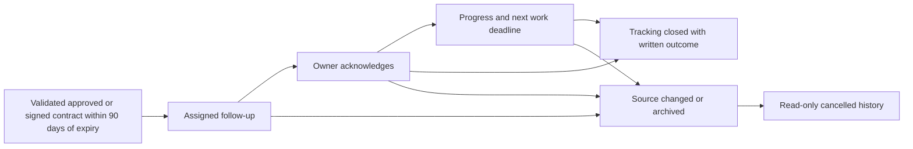

# Contract renewal follow-up

This implementation turns upcoming expiry dates into saved follow-up records under **Documente → Reînnoiri**. It tracks a person and their next action while preserving the contract and its approval evidence.

## Review in the app

1. Restart the API so Alembic installs migration `f6a9c182b407` and startup checks the contract deadlines
2. Open **Documente → Reînnoiri** as Ana or the relevant department reviewer
3. Inspect the contract expiry, next work deadline, 90/60/30-day reminders and assigned employee
4. As Ana, use **Reatribuie** to assign yourself when the current owner is another employee
5. Use **Preiau reînnoirea**, then **Adaugă progres** to save a next step and its work deadline
6. Reopen **Istoric** or restart the API to verify that acknowledgement and notes persist
7. Use **Închide urmărirea** only after recording an outcome; the contract expiry remains unchanged

The displayed reference date uses the configured reference date shown in the interface. Reminders use `FLYLEAF_REFERENCE_DATE`. They do not send emails, contact suppliers, renew legal terms or move money.

## Ownership and lifecycle

One case refers to one contract version and expiry date. The first work deadline is 30 days before expiry. Reminders are retained at 90, 60 and 30 days and reached thresholds are recorded once, including a late first check. All changes commit in write transactions so duplicate checks and stale user actions do not overwrite another person's work.

The default owner is an active eligible reviewer in the contract's department, falling back to a director. The original `Document.owner` is a display name, so it is not silently resolved to a user. The queue records an explicit employee ID.

Only the assigned eligible employee can acknowledge, progress and close. Directors and appointed department heads can explicitly reassign and preserve the reason. A new owner must acknowledge again. Existing delegation grants apply to approvals and do not automatically authorize renewal work. Offboarding clears open-case ownership and acknowledgement while retaining the previous employee in history. Reactivation still requires explicit reassignment.

## Implementation

### Document filters and alert decisions

In **Documente → Toate documentele / Contracte**, creation and expiry date ranges are inclusive. Sort by creation, update, expiry, title, registration number, owner, supplier or value in either direction. Sorting happens before pagination; missing values remain last. **Metadate și urmărire** adds a scalar metadata field/value filter, validation state and follow-up state. Filters, sort and page survive opening a document and returning to the register. The export button explicitly exports the complete accessible register.

Open a document and use **Alerte și urmărire**:

| Action | Scope and effect |
|---|---|
| **Amintește-mi pe…** | Personal. Suppresses the user's expiry/renewal actions until the chosen date, when a reminder appears in Home. Approval tasks and other users' alerts remain active. |
| **Reia alertele mele / Încheie mementoul** | Removes the personal reminder and restores ordinary expiry/renewal actions. |
| **Nu se reînnoiește** | Director or the document's department head records a reason and an eligible responsible employee. Suppresses expiry follow-up for the airport and pauses automatic renewal reminders. Cases remain accessible under **Închise / nereînnoite**. |
| **Reia urmărirea reînnoirii** | Authorized reversal with a reason; ordinary follow-up resumes and previous decisions remain in the audit history. |
| **Mută în arhivă** | Uses the existing authorized archive workflow. Keeps files and history, removes expiry follow-up and cancels pending document tasks. |

Reminders and non-renewal decisions are bound to the current document version and expiry date. A new version or changed expiry requires a fresh decision; old suppression is not inherited. Optimistic revisions reject concurrent edits. Dates and document status are never extended or modified by reminder/non-renewal actions. Register validity counters still describe actual dates; muted rows retain factual expiry labels without alarm colors.

Persistence lives in `document_reminders` and `document_renewal_decisions` (migration `b7d4029e1a63`). `POST /api/documents/{id}/follow-up` accepts `snooze`, `clear_reminder`, `do_not_renew`, and `resume_renewal`, with the document version and the applicable reminder/decision revision. The local reference date governs scheduled reminders, as it does other deadlines.

| Area | Files |
|---|---|
| Persistence and optimistic revision checks | `backend/app/renewals/models.py`, `schemas.py`, `service.py` |
| Authorized API | `backend/app/renewals/router.py` |
| Startup and periodic checks | `backend/app/main.py`, `renewals/service.py` |
| Offboarding | `backend/app/people/management.py`, `service.py` |
| Queue and action forms | `frontend/src/features/contracts/ContractRenewals.tsx`, `renewals.css` |
| Populated upgrade and source constraints | `backend/tests/test_renewal_migrations.py` |
| Thresholds, permissions, persistence and original evidence | `backend/tests/test_contract_renewals.py` |

The migrations extend current main without changing existing document files. Equipment, Home, and the dedicated assistant are documented in [the product guide](product/PRODUCT_GUIDE.html).
