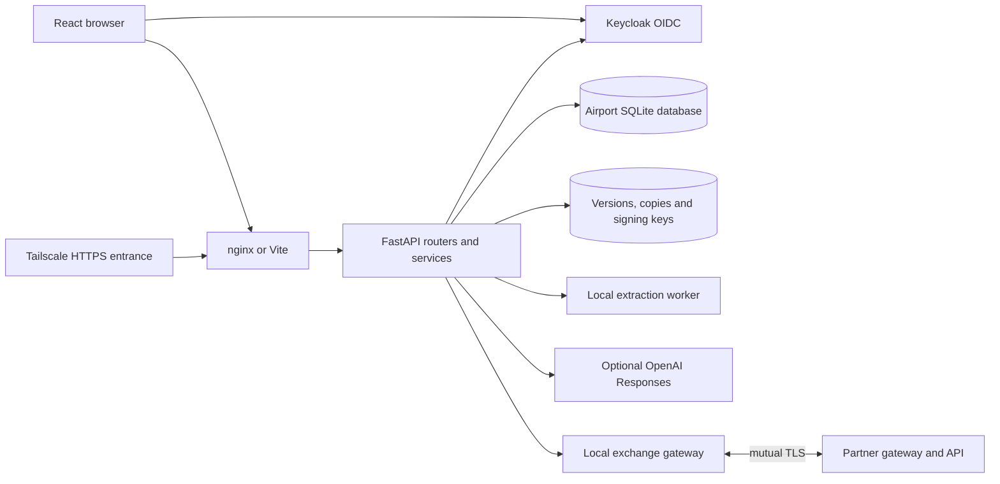
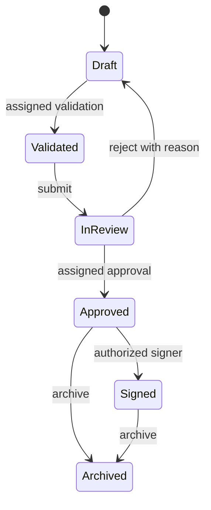
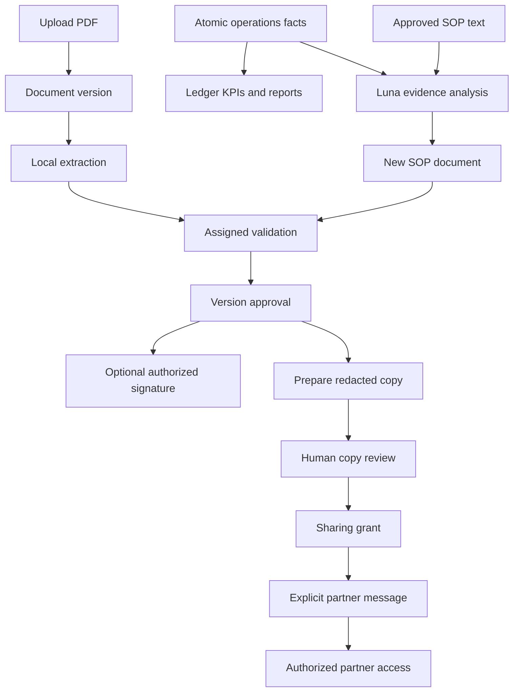

# FlyLeaf module architecture

This describes the implementation in the repository, including the atomic operations ledger and named-contact collaboration. Paths are relative to the repository root. [Setup](../README.md) and [concepts](TECH_STACK_AND_CONCEPTS.md) cover usage and terminology.

## System shape

FlyLeaf is a modular FastAPI application with a React client. Modules share one database **within an airport**. Docker runs an independent application, identity realm and state volume for each airport. The gateways exchange permitted data; they do not mount either airport's database or document store.

`backend/app/main.py` composes routers, CORS/origin checks, error handling and startup. Startup validates identity configuration, applies Alembic migrations, seeds missing records, queues extraction backfill and starts the worker. `database.py` owns SQLAlchemy sessions; `config.py` owns environment settings. No Celery, Redis, vector database or separate BI warehouse is required.

The usual request path is **router → schema validation → authenticated domain service → scoped ORM queries/files → transaction/audit → response**. Frontend capabilities guide the interface, but services enforce authority. Some modules have only services because other routers invoke them.

## Module index

| Backend module | Main frontend surface | Responsibility |
| --- | --- | --- |
| `core`, `identity` | `auth`, application shell | Sessions, OIDC, authorization, signatures and business audit |
| `documents` | `documents` | Versioned register, PDF representations and procurement graph |
| `extraction` | Document details and redaction studio | Background native text/OCR and word geometry |
| `workflows`, `tasks` | `approvals`, document details | Version-specific validation, approval, signature and assigned work |
| `people` | `people`, shared person components | Organization, employees, appointments, profiles, leave and delegation |
| `suppliers` | `suppliers` | Registry, onboarding, bank-change verification and linked contracts |
| `operations` | `operations`, people/NFC, dashboard | Current shift, atomic ledger, entities, timeline, map and traffic |
| `operations/procedures` | SOP library and strategies | SOP templates, evidence selection, AI analysis and drafts |
| `llm` | Luna controls in sharing/strategies | Shared structured Responses adapter |
| `sharing` | Redaction studio and sent copies | Derivative review, grants, expiry and revocation |
| `exchange` | Received copies, partner directory | Peer resolution and authorized remote document access |
| `collaboration` | Mailbox and airport directory | Opt-in, contacts, conversations, synchronization and personal folders |
| `reports` | `reports` | Authorized administrative and operations analytics |
| `contracts` | `dashboard`, `audit`, document/report views | Retained portfolio API, home summary and business audit endpoints |
| `seed`, deployment/scripts | No dedicated screen | Corpus initialization, local fixtures, launchers and isolation |

## 1. Application shell and shared frontend

**Code:** `frontend/src/app/App.tsx`, `styles.css`, `theme.css`; `services/api-client.ts`, `navigation.ts`, `access.ts`; `types/index.ts`; `components/ui`, `components/documents`, `components/people`; `utils`.

The shell owns the authenticated session, page capabilities, navigation, notifications, document detail context and cross-page revision refresh. Hash navigation supports deep links while retaining the originating page/list state when opening documents. The operations scene remains mounted across workspace navigation to avoid unnecessary scene/tile reloads. An expired API session invalidates the local session and shows login instead of repeating request-error notifications.

Shared components supply dialogs, fields, status/KPI styles, a read-only paginated PDF viewer and person cards. The viewer requests permitted PNG pages or downloads the underlying permitted representation. It does not imply browser annotations are saved. `frontend/src/features/reports-design` is a reference/inspiration surface at `/reports-design`, not a separate reporting data source.

**Boundary:** UI state, filters and optimistic feedback do not confer permissions. Browser-local drafts are scoped to user/airport and are not server-backed cross-device drafts.

## 2. Identity, security, signing and audit

**Code:** `backend/app/core/{auth_router,security,audit,signing,models}.py`, `identity/{router,service,origins,provisioning,sync_usernames,models}.py`; `frontend/src/features/auth`.

**Persistence:** `people.models.User` and `Session`, `identity.models.LoginTransaction`, `core.models.AuditEvent`; per-user signing material in the storage keystore.

**Entry points:** `/api/session`, `/api/auth/login`, `/api/auth/logout`, `/api/auth/oidc/login`, `/api/auth/oidc/callback`; employee provisioning is exposed through `people`.

Local mode validates a password and stores an opaque hashed session token. OIDC mode uses authorization code + PKCE, state/nonce, issuer/audience/signature validation and an airport-local identity mapping. Login transactions bind the intended browser origin. Keycloak provisioning is a backend service-client operation; users do not receive its secret. An active local account and server-side record checks remain authoritative after authentication.

Signing checks the exact approved version/hash and assigned signature task before creating a separately stored signed PDF through pyHanko. Verification checks integrity and the pinned local certificate. The certificates are self-signed demonstration credentials. Business mutations write descriptive audit events with actor, document and time. The separate atomic ledger below has stronger immutable-fact semantics than this general audit table.

**Dependencies:** people/account records, document versions, assigned tasks, local files, Keycloak only in OIDC mode.

## 3. Documents and procurement dossiers

**Code:** `backend/app/documents/{router,schemas,service,models,classification,flow,representations}.py`; `frontend/src/features/documents`.

**Persistence:** `Document` is the stable business record. `DocumentVersion` stores each version's path, hash, snapshot, approval and signature metadata. File bytes live in storage, not in a SQL blob column. Search uses SQLite FTS5 alongside authorized record filtering.

**Entry points:** `/api/documents`, `/api/documents/flow`, `/{id}`, `/{id}/versions`, `/{id}/actions`, `/{id}/file`, `/{id}/extraction`, `/{id}/verify` under the documents prefix.

Upload creates a draft and a validation task, then queues extraction. Metadata suggestions and page references remain reviewable. Replacing a PDF appends a version and requires renewed review. Procurement graph edges come from explicit `metadata.flow_links` when available, otherwise the legacy relationship inference; only readable documents in the same dossier can be connected. Contracts remain a document category.

`representations.py` renders permitted PDF pages and exports accessible text/tables to DOCX. Export reads only the already authorized PDF, including a shared redacted derivative; it does not recover hidden original text. Formatting/OCR fidelity still needs human review before reuse.

**Dependencies:** security, extraction, tasks/workflows, audit, signing and storage. **Important invariant:** a document ID is not a permission or a guarantee that its newest version has approval.

## 4. Extraction and local OCR

**Code:** `backend/app/extraction/{models,service,worker,engine}.py`; `frontend/src/features/documents/ExtractedText.tsx`.

**Persistence:** `Extraction` queue/results associate processing with version/hash and pipeline identity. Stored page data includes text, word rectangles, method and review warnings.

The worker runs the CPU-only parser in a disposable process. It checks source hashes, routes each page to native extraction or OCR, applies resource bounds and stores results. `pdf-inspector` assists routing; PyMuPDF provides extraction/OCR geometry using bundled `data/tessdata/ron.traineddata` and `eng.traineddata`. The UI can inspect the result or explicitly retry failures. Startup backfills missing extraction jobs.

**Dependencies:** immutable document versions, local models/files. No OpenAI call or hosted OCR fallback. **Consumers:** full-text search, metadata rules, redaction selections and approved SOP text analysis.

## 5. Workflows and assigned tasks

**Code:** `backend/app/workflows/service.py`, `tasks/{router,models,schemas,service}.py`; `frontend/src/features/approvals`.

**Persistence:** `WorkflowTask`, `TaskEvent`, plus state/approval fields on documents and versions.

**Entry points:** document `/{id}/actions` delegates to `apply_action`; `/api/tasks`, `/{id}/assign`, `/{id}/comments` manage assigned work.

`Validated` describes the validation flag while the document remains a draft. The service checks task ownership/delegation, department authority, expected version and file integrity. SQLite write locking serializes critical approval/signature actions. Reassignment records the new owner, due date and reason. An inactive assignee leaves work requiring reassignment rather than granting someone else implicit authority. Leave documents take decisions through the leave service instead of this generic action path.

## 6. People, organization and leave

**Code:** `backend/app/people/{router,service,management,organization,profile,leave_documents,models,schemas,names,sync_demo_organization}.py`; `frontend/src/features/people`, shared person components.

**Persistence:** `User`, `UserProfile`, `Department`, `HeadAppointment`, `Delegation`, `LeaveRequest`, `Session`.

**Entry points:** `/api/people`, `/{id}/profile`, provisioning/identity/account actions, `/appointments`, `/delegations`, `/leave`, `/me/presence`, `/me/status-message`, photo endpoints.

Basic directory/organization views are available separately from sensitive HR/account editing. Main department-head appointments require director approval; an old role label alone does not make someone a current head. Profile visibility, account activation, signing authority and provisioning are distinct operations. Dated delegation resolves who may handle assigned tasks. Leave requests generate versioned PDFs; their decision workflow updates the corresponding document without asking users to maintain a second independent decision.

The NFC station is surfaced from the team page but its attendance events belong to operations. An operational staff entity is not automatically the same identity as an authenticated application user.

**Dependencies:** identity provisioning, documents/PDF generation, tasks, audit and operations UI.

## 7. Suppliers

**Code:** `backend/app/suppliers` contains separate catalog, review and registration routers/services, schemas/models, assignment, checks, query and validation helpers. UI lives in `frontend/src/features/suppliers`.

**Persistence:** `Supplier`, `SupplierContract`, `SupplierReview`, `SupplierRegistration`.

**Entry points:** `/api/suppliers`, `/api/supplier-reviews`, `/api/supplier-registrations` and their verify/approve/reject/assign operations.

The registry opens first and links business records to documents/contracts. New suppliers and bank-detail changes are distinct review cases. Known supplier identity does not automatically validate a new IBAN. A human records verification through a known channel; a separately authorized approver decides the change. History and assignment remain inspectable. Access to ordinary business details does not grant access to bank history/workflows.

**Dependencies:** account permissions, documents/contracts, audit. **Boundary:** no payment execution, bank-account ownership verification API or real banking integration.

## 8. Operations: current shift, map and NFC

**Code:** `backend/app/operations/{router,schemas,service,scenario,models,traffic,map_config}.py`; `frontend/src/features/operations/{index,AirportScene,FlightMap,SimulationTimeline,NfcStation,RunArchive,OperationsPulse}.tsx` and motion/input/model helpers.

**Persistence:** `OperationSimulation` stores the current run/clock and controls. `OperationEvent` records run inputs/actions. Runs and source events survive ordinary navigation; explicit reset starts another run.

**Entry points:** `/api/operations`, `/control`, `/timeline`, `/events`, `/nfc`, `/runs`, `/summary`, `/traffic` and map configuration.

Scenario fixtures provide a small set of flights and selectable outcomes. Pause/play, time scrubbing and camera tracking are presentation controls over recorded/projected state. Commands, such as recording attendance or opening a gate, pass domain validation before persistence. A replacement opening a gate records reassignment separately from the opening. Card retry handling prevents duplicate attendance from becoming unrelated events.

The 3D layer turns geographic route/state data into visual movement. Live ADS-B is a separate external data source with caching/polling limits and buffered interpolation in `live-motion.ts`; it does not generate the authoritative operational ledger. Google 3D is optional. Wheel/input isolation and scene retention are frontend concerns.

**Boundary:** NFC currently needs the authorized attendance flow. It is not a no-login GET callback. Map animation positions are not airport safety/control instructions.

## 9. Atomic operations ledger and entity history

**Code:** `operations/{event_rules,ledger,atomic_ledger}.py`; `frontend/src/features/operations/{Ledger,LedgerInspector}.tsx`.

**Persistence:** `OperationLedgerGroup` groups history for browsing; `OperationFact` stores immutable actual-event snapshots; `OperationEntity` stores independently inspectable entities; `OperationFactEntity` links facts to entities and their roles.

**Entry points:** `/api/operations/ledger`, `/ledger/entries/{event_id}`, `/entities/{entity_id}`, `/facts/{event_id}`.

`event_rules.py` defines controlled event kinds and transitions. Each transition belongs to an activity stream; cross-stream prerequisites form a directed acyclic graph. Fueling, cleaning and baggage work can overlap, while readiness requires their completion plus boarding/load documentation. Assignment, attendance, gate opening and aircraft movements are separate facts. Observations such as an absence alert do not pretend to move the aircraft's physical state.

See the [state-machine diagrams and guard table](ATOMIC_OPERATIONS_LEDGER.md#state-machines) for aircraft movement, concurrent ground activities and the conditions that allow each transition. The separate [event-dependency graph](ATOMIC_OPERATIONS_LEDGER.md#dependencies-between-activities) shows how those machines coordinate before departure.

The read model groups by date/flight/work order, then exposes atomic rows and parallel activity timelines. Entity inspection opens a person's/gate's/flight's history. Fact inspection exposes before/after state, planned/actual and recorded/indexed times, participants, recorder and dependency links. Deep links resolve the exact fact outside the current scenario/date filter and preserve the return path to strategy evidence.

New accepted source events and their audit projection persist together. Historical indexing is idempotent. Facts have immutable snapshots/hash checks and database update/delete protection; forecasts are not inserted as actual facts. Legacy entries remain visibly unverified where their original rules/timestamps were not known. [Detailed schema, research and invariants](ATOMIC_OPERATIONS_LEDGER.md).

## 10. SOP library and optimization

**Code:** `operations/procedures/{catalog,service,engine,pdf}.py`, `operations/strategies.py`; `frontend/src/features/operations/{Strategies,ProcedureReader}.tsx` and procedure types/styles.

**Persistence:** SOPs use ordinary `Document`/`DocumentVersion` records. `StrategyAnalysis` stores model/input fingerprint, running/completed state, evidence snapshot and recommendations. The catalog includes twelve original working templates.

**Entry points:** `/api/operations/sops`, `/sops/{code}/draft`, `/strategy-analysis`, `/strategy-analysis/{id}/recommendations/{id}/draft`; older deterministic `/strategies` endpoints remain.

Analysis selects observed affected/unaffected case evidence within a budget and reports coverage. Pending events, staff names, NFC IDs and free-form notes are excluded from operational model evidence. Current approved procedure text supersedes a template when available. The engine validates output shape and cited IDs, keeps assumptions/risks and proposed pilot criteria, and caches results by input/model/prompt fingerprint. New evidence marks the saved result stale.

Draft creation is idempotent and enters existing validation/approval. It never mutates an approved SOP. The user can inspect cited ledger entries, then share an approved procedure through the existing grant flow. Recipient adoption remains local. See [SOP details](SOP_OPTIMIZATION.md).

## 11. LLM adapter and register assistant

**Code:** `backend/app/llm/service.py`; `assistant/{router,service}.py`; `frontend/src/features/assistant`.

The shared LLM adapter calls OpenAI Responses with a strict JSON schema, explicit token/time limits, bounded concurrency, `store: false`, a server-side key and task-specific model selection. It maps timeout, refusal, malformed result and rate-limit failures into domain errors. It does not log credentials/prompts. Operational analysis and redaction perform their own semantic/reference checks above the adapter.

The register assistant at `POST /api/assistant` is deterministic: it queries/retrieves authorized records and returns sources. It is intentionally distinct from Luna's generative analysis.

**Dependencies:** HTTPX/settings for LLM; document security/query services for the assistant. **Boundary:** structured JSON and valid source IDs do not prove an interpretation is correct.

## 12. Redaction and sharing grants

**Code:** `backend/app/sharing/{router,schemas,models,service,studio,suggestions,legal,thumbnails}.py`; `frontend/src/features/sharing/{RedactionStudio,RedactionCanvas,AttachmentPreparation}.tsx`.

**Persistence:** `SharePreview` stores a review candidate; `Share` binds a reviewed derivative, source version/hash, recipient scope, expiration and revocation state. Originals and derivative files remain distinct.

**Entry points:** document `/redaction-layout`, `/redaction-pages`, `/redaction-matches`, `/redaction-analysis`, `/redaction-suggestions`, `/share-preview`, `/shares`; `/api/shares` and preview/file/thumbnail/revoke routes.

The studio combines stored text geometry, manual area/word selection and optional contextual Luna advice. A candidate derivative is rendered for human inspection before a grant can be authorized. Version changes invalidate stale preparation. Sensitive source access and approved/signed status are enforced on the server, including SOP publication authority. HR records are excluded from partner sharing.

**Dependencies:** documents/versions, extraction, LLM, legal-reference catalog, audit, exchange registry and storage. **Boundary:** expiry/revocation blocks new source access, not already downloaded copies. Named-message attachment grants are currently airport-wide; conversation participants are not the entire grant's access policy.

## 13. Airport exchange transport

**Code:** `backend/app/exchange/{registry,router,service}.py`, `deploy/gateway.conf`, `gateway-entrypoint.sh`; received-library/PDF components in the frontend.

**Entry points:** authenticated peer `/api/exchange/shares` and `/shares/{id}/file`; local `/api/received`, `/{id}/file`, `/{id}/thumbnail`.

The registry maps configured airport IDs to fixed gateways. Source APIs check authenticated peer identity, requested user context, share audience, expiry/revocation, exact version and file integrity. The recipient receives only a permitted derivative. Browser-facing proxies block `/api/exchange/`. Docker gateways use mTLS between airports and independent app-to-gateway secrets. No gateway has a database/document volume.

The four-airport development fixture uses a separate loopback relay with per-instance tokens and fixed routes. It exercises collaboration without pretending that local HTTP is equivalent to the Docker mTLS transport.

## 14. Partner directory and conversations

**Code:** `backend/app/collaboration/{router,schemas,models,participation,service}.py`; `frontend/src/features/sharing/{Mailbox,MailWorkspace,AirportDirectory,AirportMap,AirportIdentity,ContactDirectory,Coordination,CoordinationDetails,useCollaborationInbox}`.

**Persistence:** `CollaborationParticipation`, `CollaborationThread`, `CollaborationEvent`, `CollaborationSync`, `CollaborationMailboxState`.

**Entry points:** `/api/collaboration`, `/participation`, `/airports`, `/{id}`, `/{id}/messages`, `/{id}/status`, `/{id}/mailbox`; peer `/api/exchange/collaboration`.

Directors control opt-in with revision checks. Published contacts include current directors/main department heads and professional contact fields. New conversations require an explicit recipient and are visible only to eligible named participants. Older department-routed history retains its documented compatibility rules. Read/star/archive state belongs to the local user; delivery means persisted by the other application, not read by a person.

Locally authored events are pulled by the peer over its authenticated read-only exchange. Idempotency keys make retries safe. Visible authorized clients drive synchronization; one peer's outage is reported independently. Sending a message neither creates nor broadens a document grant. The author explicitly attaches an already reviewed grant. See [contract and four-airport setup](PARTNER_COORDINATION_API.md).

## 15. Reports and home dashboard

**Code:** `backend/app/reports/{router,service,briefing,operations}.py`; `frontend/src/features/reports` (dashboard/model/charts, operations report, report library/table/export); `frontend/src/features/dashboard`.

**Entry points:** `/api/reports`, `/briefing`, `/operations`, `/{report_id}`, `/{report_id}/export.csv`; `/api/dashboard` serves the home view.

Administrative reports share a request-scoped, permission-filtered source snapshot for summaries and drill-through. They cover document health, tasks, procurement, contract exposure, suppliers, staffing and shared copies. Currency totals remain separate. Source dialogs/export retain the matching records. Browser print provides PDF output; CSV encoding protects spreadsheet formula cells.

Operations reports read persisted ledger groups and actual current-run events. Reading a report does not seed or advance a shift. Completed movements define delay denominators; the view exposes incomplete coverage rather than inventing history. Time buckets and administrative `as_of` behavior are explicit in [REPORTS.md](REPORTS.md). Refresh is visibility-aware, and failed authorization clears stale displayed data.

## 16. Retained contract API and business audit UI

**Code:** `backend/app/contracts/{router,service}.py`; `frontend/src/features/{dashboard,audit}`.

**Entry points:** `/api/contracts`, `/api/dashboard`, `/api/audit`, `/api/reports/register.csv`.

There is no separate Contracts navigation page. This module remains as a compatibility/query layer for document-backed contract/deadline information, home counts, register export and general audit. It does not define an independent contract storage model. Supplier-to-contract links belong to the suppliers module. Audit filters and source-document navigation respect the current user's visibility.

## 17. Initialization, infrastructure and migrations

**Code:** `backend/app/{main,config,database,seed}.py`, `backend/alembic`, `data`, `scripts`, `deploy`, `compose.yaml`, `compose.dev.yaml`, `compose.tailscale.yaml`.

- **Native:** `scripts/dev.sh` uses `.runtime/flyleaf.db` and `.runtime/storage`; default API 8000, UI 5173, local authentication.
- **Docker:** `scripts/start-demo.sh` prepares exchange material and starts project `flyleaf`; each airport has separate state/identity volumes. APIs migrate on startup; nginx presents apps at 8080/8081 and Keycloak at 8180/8181.
- **Live reload:** `compose.dev.yaml` mounts code into the same Docker environment.
- **Tailscale:** `scripts/start-tailscale.sh` adds remote web entrances on 18080/18081 to the existing per-airport APIs/realms. `.env.tailscale` only supplies origins. It does not copy databases or require developers to use Tailscale.
- **Four-airport fixture:** `scripts/collaboration_demo.py`, `demo_login.py`, `demo_documents.py` and PowerShell launchers manage independent local databases, fixed relay routes and sample conversations. This is separate from normal native and Docker state.
- **Corpus:** `data/seed-manifest.json` has 148 documents; `procurement-scenarios.json` adds 22. Source PDFs and OCR models ship with the repository. Missing document IDs are imported, existing versions are preserved. Runtime state, private keys and provider secrets are ignored by Git.

Alembic migrations version schema changes and compatibility upgrades. New fixtures must not overwrite edited business documents or falsify historical timestamps. Back up DB, document storage and relevant identity/signing state as one installation before upgrades.

## Cross-module flows

The reusable center is the versioned document workflow. Leave decisions, procurement dossiers, SOP drafts and partner attachments reuse it instead of creating independent approval mechanisms.

## Verification map

| Concern | Where to look |
| --- | --- |
| Permission/tenant boundaries, versioning, sharing, identity | `backend/tests` matching the domain modules |
| State transitions, parallelism, immutable facts and history | `test_atomic_operations.py`, `test_operations*.py`, ledger/preset/evidence tests |
| AI references, staleness and draft idempotency | SOP/procedure/strategy tests |
| Reporting source accuracy and query behavior | report tests including briefing and operations |
| Navigation, dialogs, ledger entity inspection, mailbox and charts | `frontend/tests/*.test.mjs` |
| Reproducible dependencies and type/build checks | lockfiles and [README commands](../README.md#checks-and-reproducibility) |

Use an isolated Chrome DevTools browser context for interactive checks. Keep screenshots/test databases under `.runtime/` or `.work/`, apart from intentionally published documentation assets. Architecture diagrams here describe software boundaries, not production certification or completed third-party airport integrations.
