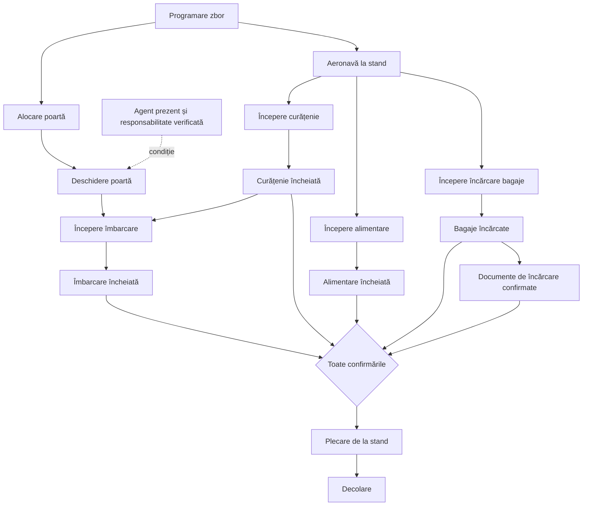
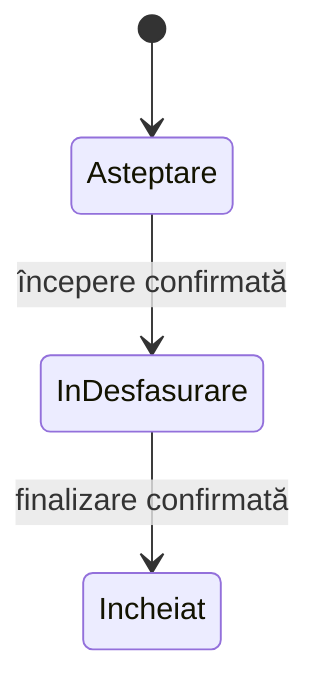
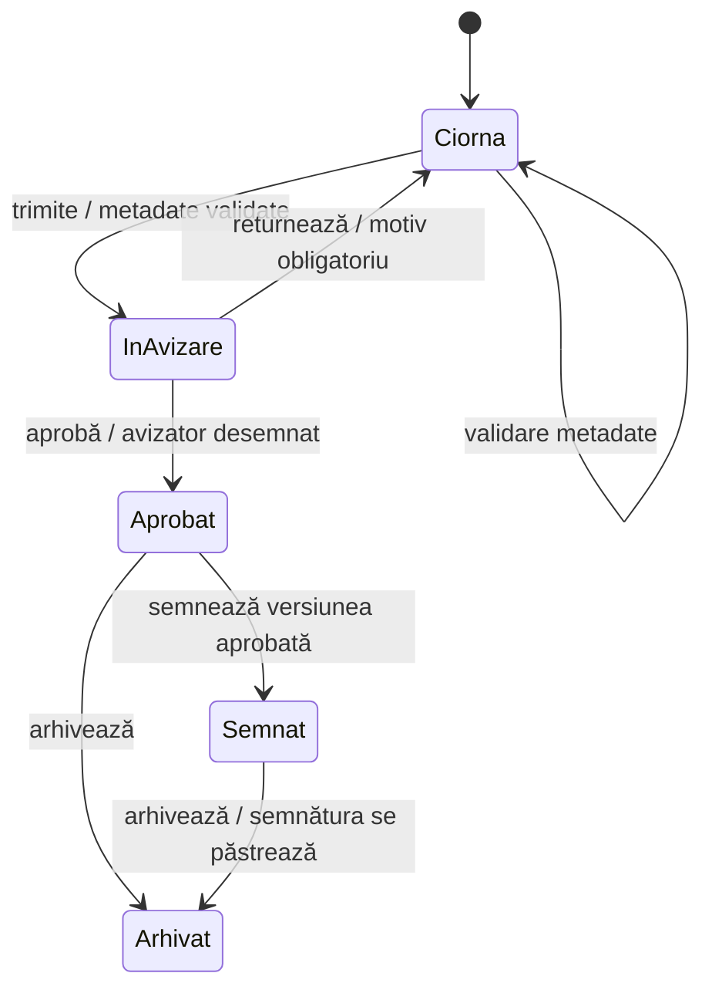

# Diagramele FlyLeaf: operațiuni și documente

## Unde se văd

- **Operațiuni la sol → Registru → deschide un zbor sau o activitate**: diagrama dependențelor; selectează un nod pentru ore, abatere și dovada originală. „Stările unei activități” arată tranzițiile acelei activități, inclusiv reveniri, precum poartă deschisă/închisă.
- **Documente → deschide documentul → Aprobări**: starea versiunii și tranzițiile permise, cu condițiile lor. Selectează o stare pentru explicații.
- **Documente → Flux achiziții**: relații între documentele unui dosar, inclusiv livrări parțiale, recepții reunite, retur și referințe. Fiecare document are separat propriul traseu de aprobare.

## Operațiuni: modelul local de plecare

O operațiune atomică este un eveniment care schimbă starea unei singure activități. Atomicitatea nu înseamnă că toate activitățile sunt secvențiale. Curățenia, alimentarea și bagajele au fluxuri independente; pregătirea plecării cere confirmarea tuturor intrărilor configurate.

Diagrama aplicației se generează din `backend/app/operations/event_rules.py` și din dependențele păstrate în registru. Include și evenimentele de personal, poartă, alertă și activitățile aeroportuare prezente în grupul selectat. Confirmările cerute de o regulă, dar absente, apar distinct și nu devin fapte sau indicatori de activitate efectuată.

Pentru curățenie, alimentare sau bagaje, mașina de stări este:

Întârzierea este o dimensiune separată: o alimentare încheiată cu întârziere rămâne „Încheiat”, cu un nod roșu sau galben. Verde înseamnă operațiune înregistrată fără abatere; gri indică lipsa confirmării, iar albastru o estimare. Pragurile locale ale aplicației sunt 1–14 minute și ≥15 minute; nu reprezintă o limită legală universală și nu implică anularea zborului.

Săgețile continue reprezintă dependențele înregistrate; cele întrerupte sunt condiții pentru operațiunile neconfirmate. Observațiile rămân vizibile în registru, fără a fi tratate drept schimbări de stare. Istoricul anterior validării regulilor nu este reclasificat retroactiv drept validat.

Acesta este modelul implementat în FlyLeaf, inspirat de abordarea pe repere și alerte descrisă de [EUROCONTROL A-CDM](https://www.eurocontrol.int/concept/airport-collaborative-decision-making). Procedurile locale, operatorul, handlingul și ATC stabilesc condițiile pentru utilizarea într-un aeroport; diagrama nu este o autorizare de pornire sau decolare. Modelul actual permite ca aeronava să fie deja aterizată la începutul rotației și nu modelează toate autorizările ATC.

## Documente: versiunea este unitatea aprobării

Validarea metadatelor este un atribut separat de starea documentului; nu sare peste aprobare. Returnarea redeschide validarea. O versiune nouă sau editarea metadatelor reia traseul ca ciornă, păstrând istoricul versiunii precedente. Semnarea verifică integritatea fișierului și aprobarea acelei versiuni. Arhivarea anulează sarcinile rămase, dar nu șterge semnătura.

Condițiile de stare provin din aceeași definiție folosită de serviciul de workflow. Rolul, departamentul, responsabilul sarcinii, versiunea și integritatea fișierului rămân verificate pe server. Documentele generate din cereri de concediu își păstrează fluxul separat din Echipă → Concedii.

## Ce s-a corectat în prezentarea fluxurilor

- Traseul liniar al documentului ascundea returnarea și arhivarea fără semnare. Diagrama arată aceste ramuri.
- La documentele semnate și apoi arhivate, vechiul traseu marca semnarea drept neefectuată. Starea se citește acum din versiunea semnată.
- În Flux achiziții, legăturile deduse din `related_ids` sunt afișate ca **asocieri**, fără condiție de execuție. Legăturile explicite `flow_links` rămân diferențiate: dependență declarată, referință, act adițional, retur/corecție. Diagrama dosarului documentează aceste relații; nu execută automat procesul de achiziție.
- Livrările parțiale, facturile consolidate, referințele de contract și retururile au fost păstrate și verificate prin teste.
