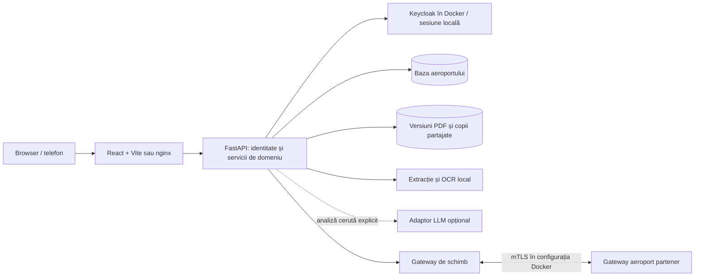

# FlyLeaf — ghid tehnic pentru evaluare

Acest document indică unde se verifică implementarea și limitele ei. Detaliile complete sunt în [arhitectura modulelor](../MODULE_ARCHITECTURE.md) și [tehnologii și concepte](../TECH_STACK_AND_CONCEPTS.md).

## Arhitectura pe scurt

FlyLeaf este o aplicație React/TypeScript și un backend modular FastAPI. În configurația actuală, fiecare aeroport are propria bază SQLite, propriile fișiere și propriile conturi. Instalațiile Docker pot utiliza Keycloak; dezvoltarea locală are autentificare cu parolă și sesiune proprie. Autentificarea și autorizarea acțiunilor sunt verificări separate.



Partenerul nu primește acces la baza locală. Mesajul, identitatea destinatarului și dreptul de a deschide documentul sunt lucruri distincte. Configurația exactă de schimb și pornirea aeroporturilor sunt descrise în [ghidul colaborării](../PARTNER_COORDINATION_API.md).

## Unde se găsește logica

| Funcție | Cod principal | Ce trebuie urmărit |
| --- | --- | --- |
| Sesiuni și autorizare | `backend/app/core/security.py`, `backend/app/identity/` | Cont activ, rol, departament, sarcină și acces la obiect; interfața nu acordă singură permisiuni. |
| Documente și aprobări | `backend/app/documents/`, `backend/app/workflows/`, `backend/app/tasks/` | Versiune și hash, metadate validate, responsabil, motivul returnării, aprobare și semnare. |
| Achiziții | `backend/app/procurement/`, `frontend/src/features/procurement/` | Dosar, șabloane, documente justificative și controale înaintea pașilor dependenți. |
| Termene și lucru personal | `backend/app/renewals/`, `backend/app/workspace/`, `documents/followup.py` | Amânare motivată, nereînnoire, responsabil și sarcini personale. |
| Echipamente | `backend/app/equipment/`, `frontend/src/features/equipment/` | Incident → atribuire → executare → verificare; disponibilitatea se confirmă separat. |
| Operațiuni atomice | `backend/app/operations/event_rules.py`, `atomic_ledger.py`, `process_graph.py` | Stări pe activitate, precondiții, dependențe și fapte distincte de estimări. |
| Echipă și concedii | `backend/app/people/`, `frontend/src/features/people/` | Ierarhie, calendar limitat la aria de acces, aprobări și delegări. |
| Colaborare | `backend/app/collaboration/`, `sharing/`, `exchange/` | Activare, contacte eligibile, copie revizuită, audiență, expirare și revocare. |
| Interfață RO/EN | `frontend/src/i18n/` | Selectarea limbii și traducerile interfeței; conținutul documentelor nu devine automat tradus. |

Pentru diagrame, consultați [mașinile de stări](../STATE_MACHINE_FLOWS.md). Fluxul documentelor unui dosar și ciclul de aprobare al unei versiuni nu sunt aceeași diagramă. La operațiuni, curățenia, alimentarea și bagajele pot evolua în paralel; plecarea depinde de confirmările definite în model. Pontajul NFC înregistrează prezența, fără a autoriza singur o plecare.

## Verificare reproductibilă

Comenzile următoare se rulează din rădăcina unui checkout configurat conform [README](../../README.md). Exemple PowerShell pentru Windows:

```powershell
git status --short
git diff --check
git diff --name-only --diff-filter=U
& .\backend\.venv\Scripts\python.exe -m alembic -c backend/alembic.ini heads
& .\backend\.venv\Scripts\python.exe -m pytest backend/tests -q
npm.cmd --prefix frontend test
npm.cmd --prefix frontend run lint
npm.cmd --prefix frontend run build
```

Pe Linux/macOS, executabilul Python este `backend/.venv/bin/python`, iar comanda npm este `npm`. Nu modificați baza unei instalații în uz pentru a executa teste: fixture-urile backend din `backend/tests/conftest.py` creează directoare și baze temporare. `alembic heads` inspectează istoricul; nu aplică migrări. Un rezultat cu mai multe capete trebuie evaluat împreună cu migrările de îmbinare.

Pentru o primă verificare a schimbărilor recente, inspectați `test_process_graph.py`, `test_atomic_operations.py`, `test_workflows.py`, `test_leave_calendar.py`, `test_equipment.py` și `test_procurement_workflows.py` din `backend/tests/`; în frontend, `state-flows.test.mjs`, `leave-range-planner.test.mjs` și `interface-language.test.mjs`. Acestea nu înlocuiesc suita completă după integrare.

Verificarea în browser trebuie făcută într-un context Playwright izolat, conform `AGENTS.md`, cu capturi în `.runtime/`. Pentru funcțiile partajate, verificați separat contul care atribuie și contul care primește; un singur cont de director nu demonstrează izolarea permisiunilor.

**Verificare după integrare, 1 noiembrie 2026:** buildul de producție reușește; ESLint nu raportează erori, cu un avertisment existent despre dependențele unui efect în `AirportMap`. Au trecut 108 teste backend pentru documente, operațiuni, migrări și echipamente, plus 46 pentru calendar, ierarhie și delegări. În frontend au trecut testele de stări, traduceri, calendar și navigare; două verificări vechi de login au fost actualizate pentru a permite selectorul RO/EN, păstrând interdicția selectorului de cont sau aeroport. Verificările în browser izolat acoperă autentificarea, păstrarea limbii, documentele, echipamentele, colaborarea, calendarul și diagramele pe desktop și telefon. Acestea sunt verificări funcționale, nu teste de capacitate sau certificări pentru producție.

Prezentarea HTML/PDF a fost verificată separat pentru cele 12 slide-uri, navigare, resurse locale și încadrare. Unele texte generate de backend și conținutul documentelor rămân în limba sursei; schimbarea limbii interfeței nu traduce automat materialele aeroportului.

## Dovezi de lucru în echipă

Istoricul Git arată contribuții pe domenii și integrarea lor. Exemple verificabile, fără estimări de ore sau deducții din numărul de linii:

| Commit | Câmpul autor în Git | Conținut inspectabil |
| --- | --- | --- |
| `63ee50d` | Andra Smarandache | Spațiu personal, urmărirea documentelor, reînnoiri și incidente pe echipamente; teste asociate. |
| `54bf696` | Andra Smarandache | Îmbunătățiri ale colaborării și meniului de profil. |
| `7b63a8b` | Paul Munteanu | Evenimente atomice, reguli, entități operaționale și teste de registru. |
| `3686e0e` | Paul Munteanu | Calendarul echipei și acoperirea aprobărilor în ierarhie. |
| `a4a5736` | Daniel Voicu | Șabloane de achiziții, verificarea dovezilor și fluxuri financiare. |
| `8344fb5`, `94fc37e` | Metadate de merge | Integrarea ramurilor de documente și registru atomic prin PR-uri separate. |

```powershell
git show --stat 63ee50d
git show --stat 7b63a8b
git show --stat a4a5736
git log --graph --oneline --decorate -25
```

Numele din Git sunt metadate de autor, nu o verificare de identitate. Mai multe aliasuri nu demonstrează mai mulți oameni, iar commiturile și liniile modificate nu măsoară orele lucrate. Schimbările încă necomise trebuie prezentate ca atare. Folosirea instrumentelor AI la dezvoltare nu schimbă nevoia ca echipa să poată explica și verifica rezultatul.

## Limite pentru utilizare în producție

- Datele și conturile livrate sunt pentru demonstrație; integrarea cu sistemele și procedurile unui aeroport trebuie validată local.
- SQLite și modul de identitate din dezvoltare nu reprezintă o demonstrație de capacitate, disponibilitate sau recuperare în producție. Sunt necesare măsurători, monitorizare și restaurări din backup testate.
- Semnăturile PDF locale utilizează certificate demonstrative; nu sunt prezentate ca semnături calificate. Registrul aplicației nu este o arhivă externă notarizată.
- Regulile operaționale nu constituie certificare A-CDM și nu înlocuiesc ATC sau autorizările operaționale. Pragurile de culoare nu sunt limite legale universale.
- OCR, exportul Word și propunerile LLM necesită revizuire umană. Contextul permis pentru un serviciu AI extern se stabilește cu aeroportul; OCR-ul local este o funcție separată.
- Interfața web pe telefon nu echivalează cu o aplicație nativă publicată. Extinderea internațională cere mai mult decât traducerea interfeței: reguli locale, integrări, suport și acorduri privind datele.

Aceste limite stabilesc ce trebuie rezolvat într-un pilot. Criteriile comerciale și măsurătorile sunt în [PRODUCT_AND_PILOT.md](PRODUCT_AND_PILOT.md).
